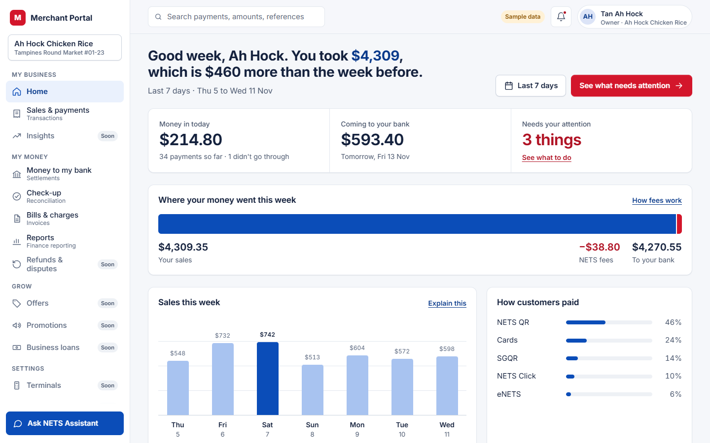
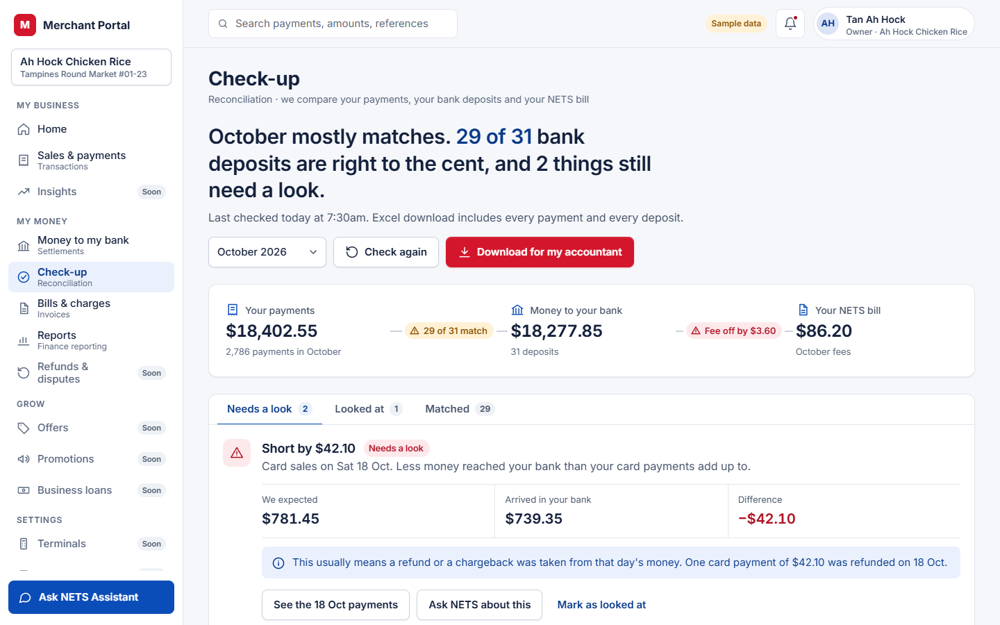
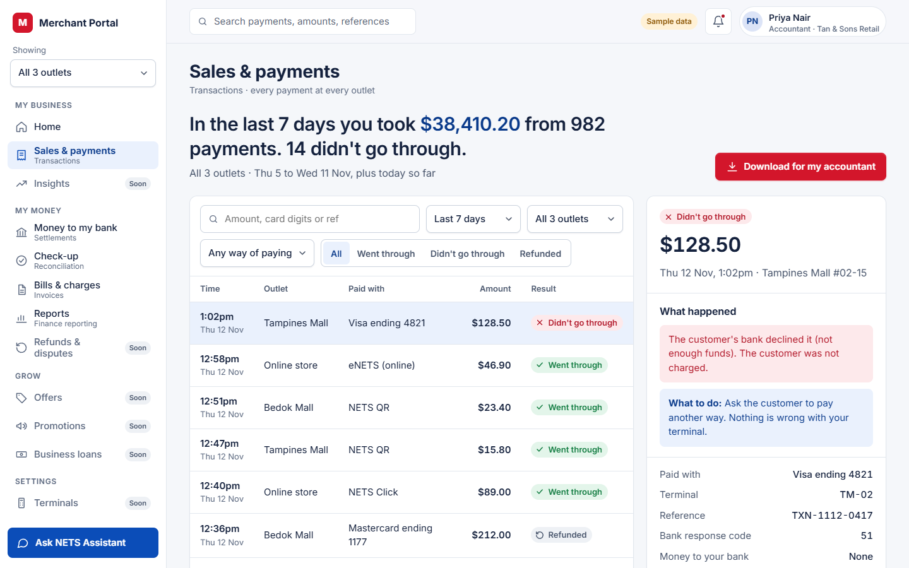

# NETS Merchant Portal (FYP prototype)

A Final Year Project with industry partner **NETS** (Singapore payments). We are designing and building an improved **merchant portal**: the website where shops that take NETS payments check their sales, see the money coming to their bank, and sort out problems.

Today, most merchants open the portal about once a month to look at an invoice. Our goal is a portal they **want** to open:

| Goal from NETS | What we add |
|---|---|
| Help merchants understand and grow their business | **Insights:** one dashboard for every NETS payment type (NETS QR, cards, SGQR, NETS Click, eNETS), with plain-English summaries such as "You took $4,309 this week, $460 more than last week" |
| Make their work easier | **Operations:** an automatic **check-up** (reconciliation) of payments against bank deposits and the NETS bill, money-to-bank tracking, and downloads for the accountant |
| Bring them back more often | **Assistant:** "Ask NETS Assistant" answers questions from the merchant's own data and the help centre. It can only read data; it never changes anything |

**Design rule: simple enough for a hawker uncle.** Plain words first, with the technical term underneath (e.g. **Check-up** / *Reconciliation*), one main action per screen, the answer first, mobile-first, and large, high-contrast text (WCAG 2.1 AA).

> All data in this project is **synthetic** (made up by our own generator). There are no real merchants or customers.

---

## Current status

**Phase: building** (14 Nov 2026). All MVP feature screens are built and tested on the `mvp` branch. Left for the MVP: deploying to Vercel with a hosted MySQL database, a final review, and a pull request into `main`.
**Next milestone:** Touchpoint 1, an MVP demo to NETS and RP, around **25 Nov 2026**.

| Area | Status |
|---|---|
| Project plan, method (Scrum, 1-week sprints + user-centred design) | ✅ Done: [docs/01-project-plan.md](docs/01-project-plan.md) |
| Technical design (architecture, database, reconciliation logic, assistant, API) | ✅ Done: [docs/02-technical-design.md](docs/02-technical-design.md) |
| Feature list and phases | ✅ Done: [docs/03-feature-catalogue.md](docs/03-feature-catalogue.md) |
| Documentation and test plan (with results) | ✅ Done: [docs/04-documentation-and-test-plan.md](docs/04-documentation-and-test-plan.md) |
| Visual design and clickable mockups | ✅ Done: [design/](design/), [DESIGN.md](DESIGN.md) |
| App in plain JavaScript, MySQL database, synthetic data generator and seed | ✅ Built |
| Login (form and demo buttons), Home, Sales & payments, Money to my bank, Bills & charges (with PDF), Check-up, Reports (Excel), NETS Assistant (quick answers), alerts bell | ✅ Built: one page per feature in [docs/features/](docs/features/) |
| Tests: unit, integration (MySQL) and end-to-end (desktop and phone) | ✅ Passing, and unit and integration run on GitHub Actions |
| Deployment on Vercel with hosted MySQL | ⬜ Not started (needs the team's OK) |
| NETS Assistant AI mode (needs an Anthropic API key) | ⬜ Later |

### MVP (Touchpoint 1) scope

- Two demo merchants that show the contrast:
  - **Ah Hock Chicken Rice:** a hawker with 1 stall, mostly using a phone
  - **Tan & Sons Retail:** 3 outlets including an online shop, with an accountant
- Login with email and password, plus one-click **"Try as…"** demo buttons
- Home dashboard, Sales & payments, Money to my bank, Bills & charges, Check-up, Reports (Excel)
- NETS Assistant in "quick answers" mode (no AI key needed); AI mode is added later
- Modules planned for later phases appear in the menu, greyed out with a **"Soon"** tag

---

## The design

We chose **"Clean Console"**: a professional, light merchant portal in red, blue and white. Blue is used for data and navigation; red is used for the logo, the one main button on each screen, and problems.

| Desktop | Phone |
|---|---|
|  |  |

| Check-up (reconciliation) | Sales & payments |
|---|---|
|  |  |

**To click through the mockups:** download or clone the repo and open [`design/index.html`](design/index.html) in a browser. No installation is needed. They are plain HTML, CSS and JavaScript, and they use sample data.

[DESIGN.md](DESIGN.md) describes the colours, text sizes, components and rules the team uses to build the real screens.

---

## Tech stack

| Part | Choice |
|---|---|
| Web app | **Next.js 15** (App Router) in **plain JavaScript** (no TypeScript), Tailwind CSS, shadcn/ui, Recharts |
| Back end and REST API | Next.js route handlers on **Node.js**; public REST API `/api/v1` |
| Database | **MySQL 8** (transactions, invoices and user data). Every query is filtered by the logged-in merchant, so each merchant only sees their own data |
| Login | Our own email + password login (bcrypt, sessions stored in MySQL) |
| Hosting | **Vercel** (planned) |
| Assistant | Rules mode now (no key needed); AI mode (Claude, Anthropic API) uses the same fixed, read-only tools. The AI never writes database queries |
| Exports | Excel (ExcelJS) and PDF (@react-pdf/renderer) |
| Tests | Vitest (unit, and integration tests against MySQL), Playwright (end-to-end) |

## Repository layout

```
docs/          Plan, technical design, feature catalogue, test plan, MVP build plan
design/        Clickable mockups (open design/index.html)
DESIGN.md      Design system: colours, type, components, rules
PRODUCT.md     Short product brief (users, purpose, principles)
app/, lib/, components/, db/   The Next.js app and the SQL migrations
scripts/       Migrate and seed commands
tests/         unit/, integration/ (MySQL) and e2e/ (Playwright)
.github/       GitHub Actions: lint, unit and integration tests
.impeccable/   Notes and screenshots from the design process
CLAUDE.md      Running project notes: decisions made and where we left off
```

## Running the app

**You need:** Node.js 22 or newer, and MySQL 8 running on your computer.

1. **Create the databases and users.** Follow [docs/database/README.md](docs/database/README.md): two databases (`nets_portal` and `nets_portal_test`) and two users (`portal_admin` for migrations and seeding, `portal_app` for the running app).
2. **Set up your settings.** Copy `.env.example` to `.env.local` and fill in the values. The names are:
   `DATABASE_URL`, `DATABASE_ADMIN_URL`, `DATABASE_SSL`, `TEST_DATABASE_URL`, `TEST_DATABASE_ADMIN_URL`, `ANTHROPIC_API_KEY` (optional), `ASSISTANT_MODE` (`rules` needs no key), `DEMO_MODE` (`true` shows the "Try as…" buttons), `DEMO_PASSWORD`, `CRON_SECRET`.
3. **Install and start:**

```bash
npm install
npm run migrate    # creates the tables
npm run seed       # creates the two demo merchants and their sample data (run again any time to reset)
npm run dev        # http://localhost:3000
```

`.env.local` holds secrets. It is ignored by git and must never be committed.

**Demo logins** (password is whatever you set as `DEMO_PASSWORD`):

| Merchant | Email |
|---|---|
| Ah Hock Chicken Rice (hawker, 1 stall) | `hawker@demo.local` |
| Tan & Sons Retail (3 outlets incl. online) | `retail@demo.local` |

With `DEMO_MODE=true`, the login page also has one-click "Try as…" buttons.

**Tests**

| Command | What it runs |
|---|---|
| `npm test` | Unit tests (no database needed) |
| `npm run test:integration` | Integration tests against the `nets_portal_test` database |
| `npm run test:e2e` | End-to-end tests in Microsoft Edge, on a desktop and an iPhone 13 screen. It builds and starts the app itself, so run `npm run seed` first and stop `npm run dev` (port 3000 must be free) |
| `npm run lint` | Code style checks |

## Team

A 4-person Final Year Project team, working with NETS as the industry partner and RP for the Touchpoint reviews.
