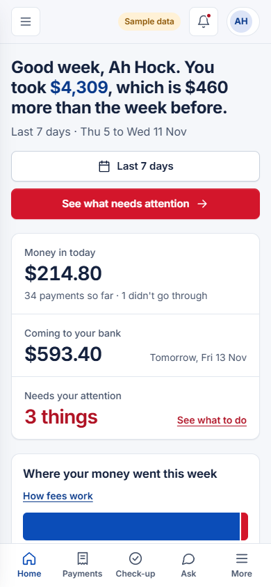

# NETS Merchant Portal (FYP prototype)

A Final Year Project with industry partner **NETS** (Singapore payments). We are designing and building an improved **merchant portal**: the website where shops that take NETS payments check their sales, see the money coming to their bank, and sort out problems.

Today, most merchants open the portal about once a month to look at an invoice. Our goal is a portal they **want** to open:

| Goal from NETS | What we add |
|---|---|
| Help merchants understand and grow their business | **Insights:** one dashboard for every NETS payment type (NETS QR, cards, SGQR, NETS Click, eNETS), with plain-English summaries such as "You took $4,309 this week, $460 more than last week" |
| Make their work easier | **Operations:** an automatic **check-up** (reconciliation) of payments against bank deposits and the NETS bill, money-to-bank tracking, and downloads for the accountant |
| Bring them back more often | **Assistant:** "Ask NETS Assistant" answers questions from the merchant's own data and the help centre. It can only read data; it never changes anything |

**Design rule: simple enough for a hawker uncle.** Plain words first, with the technical term underneath (e.g. **Check-up** / *Reconciliation*), one main action per screen, the answer first, mobile-first, and large, high-contrast text (WCAG 2.1 AA).

> All data in this project is **synthetic** (made up by our own generator). There are no real merchants or customers.

---

## Current status

**Phase: planning** (12 Nov 2026). Building starts once the team agrees the plan is final.
**Next milestone:** Touchpoint 1, an MVP demo to NETS and RP, around **25 Nov 2026**.

| Area | Status |
|---|---|
| Project plan, method (Scrum, 1-week sprints + user-centred design) | ✅ Done: [docs/01-project-plan.md](docs/01-project-plan.md) |
| Technical design (architecture, database, reconciliation logic, assistant, API) | ✅ Done: [docs/02-technical-design.md](docs/02-technical-design.md) |
| Feature list and phases | ✅ Done: [docs/03-feature-catalogue.md](docs/03-feature-catalogue.md) |
| Documentation and test plan | ✅ Done: [docs/04-documentation-and-test-plan.md](docs/04-documentation-and-test-plan.md) |
| MVP scope (2 demo merchants, demo logins, assistant without AI first) | ✅ Agreed |
| Visual design (picked from 3 options) and clickable mockups of 5 screens | ✅ Done: [design/](design/), [DESIGN.md](DESIGN.md) |
| Step-by-step MVP build plan (plain JavaScript) | ✅ Drafted: [docs/superpowers/plans/2026-11-11-mvp.md](docs/superpowers/plans/2026-11-11-mvp.md) |
| App scaffold (Next.js) | 🟡 Started, will be converted from TypeScript to JavaScript (plan Task 1b) |
| Synthetic data generator | 🟡 Partly written (plan Task 3) |
| Database, login, dashboard, payments, check-up, reports, assistant | ⬜ Not started (after planning is approved) |
| Deployment on Vercel | ⬜ Not started |

### MVP (Touchpoint 1) scope

- Two demo merchants that show the contrast:
  - **Ah Hock Chicken Rice:** a hawker with 1 stall, mostly using a phone
  - **Tan & Sons Retail:** 3 outlets including an online shop, with an accountant
- Login with email and password, plus one-click **"Try as…"** demo buttons
- Home dashboard, Sales & payments, Money to my bank, Bills & charges, Check-up, Reports (Excel)
- NETS Assistant in "quick answers" mode (no AI key needed); AI mode is added later
- Modules planned for later phases appear in the menu, greyed out with a **"Soon"** tag

---

## The design

We chose **"Clean Console"**: a professional, light merchant portal in red, blue and white. Blue is used for data and navigation; red is used for the logo, the one main button on each screen, and problems.

| Desktop | Phone |
|---|---|
|  |  |

| Check-up (reconciliation) | Sales & payments |
|---|---|
|  |  |

**To click through the mockups:** download or clone the repo and open [`design/index.html`](design/index.html) in a browser. No installation is needed. They are plain HTML, CSS and JavaScript, and they use sample data.

[DESIGN.md](DESIGN.md) describes the colours, text sizes, components and rules the team uses to build the real screens.

---

## Tech stack (planned)

| Part | Choice |
|---|---|
| Web app | **Next.js 15** (App Router) in **plain JavaScript** (no TypeScript), Tailwind CSS, shadcn/ui, Recharts |
| Back end and REST API | Next.js route handlers on **Node.js**; public REST API `/api/v1` |
| Database | **MySQL 8** (transactions, invoices and user data). Every query is filtered by the logged-in merchant, so each merchant only sees their own data |
| Login | Our own email + password login (bcrypt, sessions stored in MySQL) |
| Hosting | **Vercel** |
| Assistant | Rules mode first; later Claude (Anthropic API) with fixed, read-only tools. The AI never writes database queries |
| Exports | Excel (ExcelJS) and PDF |
| Tests | Vitest (unit, and integration tests against MySQL), Playwright (end-to-end) |

## Repository layout

```
docs/          Plan, technical design, feature catalogue, test plan, MVP build plan
design/        Clickable mockups (open design/index.html)
DESIGN.md      Design system: colours, type, components, rules
PRODUCT.md     Short product brief (users, purpose, principles)
app/, lib/, components/, tests/   The Next.js app (early scaffold)
.impeccable/   Notes and screenshots from the design process
CLAUDE.md      Running project notes: decisions made and where we left off
```

## Running the app (once building starts)

The app is not usable yet. When it is, the steps are:

```bash
npm install
cp .env.example .env.local   # fill in your MySQL connection strings
npm run migrate              # creates the tables
npm run seed                 # creates the two demo merchants and their sample data
npm run dev                  # http://localhost:3000
```

`.env.local` holds secret keys. It is ignored by git and must never be committed.

## Team

A 4-person Final Year Project team, working with NETS as the industry partner and RP for the Touchpoint reviews.
