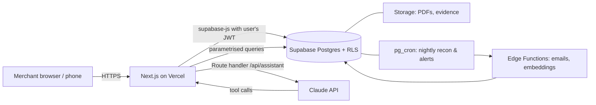
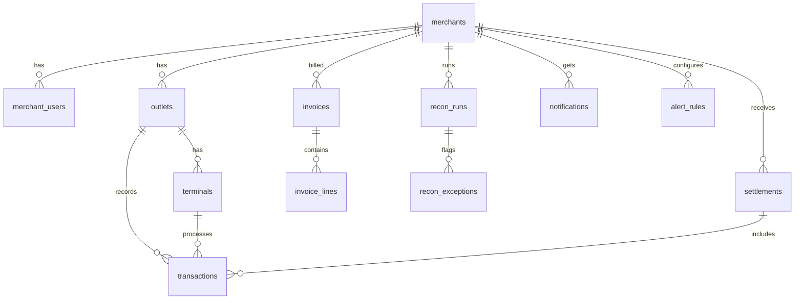

# Technical Design — NETS Merchant Portal

Version 0.1 · 2026-11-11 · Living document: update it in the same PR as any architecture change.

## 1. Database answer: PostgreSQL

**Supabase runs PostgreSQL, not MySQL.** That suits this project because Postgres gives us:
- **Row Level Security (RLS)**: each merchant can only ever see their own rows, enforced in the database itself
- **pgvector**: vector search for the AI help centre (RAG), so we don't need a separate vector database
- **pg_cron**: scheduled nightly reconciliation and alert checks
- Strong date/time and aggregation functions, which the analytics need

## 2. Tech stack

| Area | Choice | Why |
|---|---|---|
| Framework | **Next.js 15 (App Router) + TypeScript** | First-class on Vercel; server components keep secrets server-side |
| Styling / UI | **Tailwind CSS + shadcn/ui** (Radix primitives) | Accessible components out of the box, fast to theme for the chosen design |
| Charts | **Recharts** | Simple React API, responsive |
| Tables | **TanStack Table** | Sorting, filtering, pagination for transactions |
| Forms | **React Hook Form + Zod** | Validation shared between client and server |
| Database | **Supabase Postgres** | See above |
| Auth | **Supabase Auth** (email + password; MFA later) | Integrates with RLS through `auth.uid()` |
| File storage | **Supabase Storage** | Invoice PDFs, dispute evidence, exports |
| Scheduled jobs | **pg_cron** + Supabase Edge Functions | Nightly recon, alerts, weekly digests |
| Realtime | **Supabase Realtime** | Live notifications bell |
| AI model | **Anthropic Claude: `claude-opus-5-5`** via the official `@anthropic-ai/sdk` | Strong tool use for safe data queries; streaming chat |
| Embeddings (RAG) | Supabase built-in **`gte-small`** model in an Edge Function | Free, and runs inside Supabase |
| Excel export | **ExcelJS** | Formatted .xlsx with multiple sheets |
| PDF export | **@react-pdf/renderer** | Invoice and report PDFs from React components |
| Email | **Resend** (Phase 1) | Alert and digest emails |
| Testing | **Vitest** (unit), **Playwright** (end-to-end), **pgTAP** (database/RLS) | |
| CI/CD | **GitHub Actions** (lint, typecheck, tests) + **Vercel** preview deploy per PR | |
| Docs | Markdown in `/docs`, diagrams in **Mermaid** | Versioned with the code |

AI cost note: `claude-opus-5-5` costs $4 / $20 per million input/output tokens. A typical copilot question uses roughly 3–6k tokens, so it costs a few cents. If demo volume makes cost matter, high-volume background jobs (such as nudge wording) can move to `claude-haiku-5-5` ($0.10 / $0.50) later. That is a team decision.

## 3. Architecture



**Key rule: the AI never writes SQL.** The copilot can only call a fixed set of tools (e.g. `get_sales_summary(from, to, channel?)`). Each tool runs a tested, parametrised query **using the logged-in user's token**, so RLS still applies. The model cannot see another merchant's data, even if a user tries to trick it with a prompt injection.

### Folder structure (planned)

```
/app
  /(auth)/login
  /(portal)/dashboard  /transactions  /settlements  /invoices
  /(portal)/reconciliation  /reports  /assistant  /notifications
  /(portal)/offers  /campaigns  /lending  /services  /terminals
  /(portal)/business  /disputes  /integrations  /analytics  /settings
  /api/assistant/route.ts      # streaming copilot
  /api/export/[type]/route.ts  # xlsx / pdf
/components  (ui/, charts/, layout/)
/lib         (supabase/, assistant/tools/, recon/, format/)
/supabase    (migrations/, seed/, functions/, tests/)
/scripts     generate-synthetic-data.ts
/docs
```

## 4. Data model (MVP core; later phases add tables)



| Table | Key columns |
|---|---|
| `merchants` | id, legal_name, trading_name, uen, category (F&B, retail…), gst_registered |
| `merchant_users` | merchant_id, user_id (→ auth.users), role (owner/manager/cashier/accountant) |
| `outlets` | id, merchant_id, name, address |
| `terminals` | id, outlet_id, serial_no, model, status |
| `transactions` | id, merchant_id, outlet_id, terminal_id, **channel** (nets_qr, nets_click, enets, card, sgqr), amount, fee, status (success/failed/refunded), failure_code, customer_ref (hashed, for repeat-customer analysis), settlement_id, created_at |
| `settlements` | id, merchant_id, business_date, gross, fees, net, status (pending/paid/delayed), expected_date, paid_date, bank_ref |
| `invoices` | id, merchant_id, period (month), total, status (unpaid/paid/overdue), due_date, pdf_path |
| `invoice_lines` | invoice_id, charge_type (MDR fee, terminal rental, …), qty, unit_price, amount |
| `recon_runs` | id, merchant_id, period, run_at, matched_count, exception_count |
| `recon_exceptions` | run_id, type (amount_mismatch, missing_settlement, settlement_delay, failed_payment, fee_mismatch), ref ids, expected, actual, status (open/resolved), note |
| `notifications` | merchant_id, kind, title, body, link, read_at |
| `alert_rules` | merchant_id, rule_type, threshold, channel (in_app/email), enabled |
| `kb_chunks` | id, source_doc, heading, content, embedding vector(384) |
| `chat_messages` | session_id, user_id, role, content, created_at |
| `audit_log` | actor, action, entity, before/after, at |

All merchant-owned tables have `merchant_id` and an RLS policy along the lines of *"user is a member of this merchant"*.

## 5. Reconciliation logic (v1)

For a selected month:
1. **Transactions → Settlements:** sum the successful transactions per business date and channel, then compare with the settlement's `gross`. A difference greater than $0.01 is flagged as `amount_mismatch`.
2. **Missing / late settlements:** a settlement still `pending` after its `expected_date` is flagged as `settlement_delay`.
3. **Failed payments:** failed transactions are listed with the plain-language reason from the `failure_code` table.
4. **Settlements → Invoice:** recompute the MDR fees from the transactions and compare them with the invoice's fee lines. A difference is flagged as `fee_mismatch`.
5. Store the results in `recon_runs` / `recon_exceptions`, show a summary ("98.6% matched, 4 items need your attention") and allow export.

## 6. AI assistant design

- **Endpoint:** `POST /api/assistant` streams responses from `claude-opus-5-5` using tool use.
- **Data tools (MVP):** `get_sales_summary`, `compare_periods`, `get_busiest_times`, `get_channel_mix`, `find_transaction`, `explain_failed_payment`, `get_settlement_status`, `get_invoice`.
- **Help tool:** `search_help_centre(query)` embeds the query, runs a pgvector similarity search over `kb_chunks`, and returns the top passages with their source, which the answer then cites.
- **Guardrails:** the system prompt tells the assistant to answer only from tool results, to say "I don't know" rather than guess, and to always state the date range. Tools are read-only in the MVP. Any later write actions (e.g. raising a refund) need user confirmation, plus maker-checker in Phase 4.
- **Summary card:** template-based in the MVP (deterministic). The LLM is used only for the chat.

## 7. Open API & integrations (two-way)

The portal is **API-first**: our own UI uses the same versioned API that partners use, so integrations are never an afterthought.

### 7.1 Inbound: other services connect to us (Public REST API)

| Item | Decision |
|---|---|
| Style | REST + JSON, versioned base path **`/api/v1`** (Next.js route handlers on Vercel) |
| Contract | **OpenAPI 3.1** spec at `/api/v1/openapi.json`, rendered as interactive docs at `/developers` (Scalar or Swagger UI) |
| Auth (machine-to-machine) | **API keys** (P1) issued per merchant in *Settings → Developers*, stored hashed, with scopes; **OAuth 2.0 client-credentials** (P3) for partners like SAP/Xero |
| Scopes | `transactions:read`, `settlements:read`, `invoices:read`, `reports:read`, `refunds:write`, `webhooks:manage` |
| Data isolation | Every key belongs to one merchant, and queries run with that merchant's scope, so RLS still applies |
| Rate limiting | Per key (e.g. 60 req/min), via Upstash Redis or a Postgres counter; `429` + `Retry-After` |
| Conventions | Cursor pagination (`?cursor=&limit=`), ISO-8601 dates, amounts in cents (integers), `Idempotency-Key` header on POSTs, consistent error shape `{ error: { code, message } }` |
| Audit | Every API call is logged (key id, route, status) in `api_request_log` |

**Planned endpoints (v1)**

| Method | Path | Phase |
|---|---|---|
| GET | `/api/v1/transactions` · `/api/v1/transactions/{id}` | P1 |
| GET | `/api/v1/settlements` · `/api/v1/settlements/{id}` | P1 |
| GET | `/api/v1/invoices` · `/api/v1/invoices/{id}` · `/api/v1/invoices/{id}/pdf` | P1 |
| GET | `/api/v1/reports/sales?from=&to=&group_by=` | P1 |
| GET | `/api/v1/reconciliation/runs` · `/runs/{id}/exceptions` | P1 |
| POST | `/api/v1/refunds` · GET `/api/v1/disputes` | P1 (with maker-checker in P4) |
| GET/POST/DELETE | `/api/v1/webhooks` (manage subscriptions) | P1 |
| GET | `/api/v1/terminals` · POST `/api/v1/service-requests` | P3 |

### 7.2 Outbound: we notify other services (Webhooks)

- Merchants or partners register a URL and pick events
- Events: `transaction.failed`, `settlement.paid`, `settlement.delayed`, `invoice.issued`, `reconciliation.completed`, `dispute.opened`, `alert.triggered`
- Each delivery is **signed** (HMAC-SHA256 in an `X-NETS-Signature` header, plus a timestamp to stop replays)
- Retries with exponential backoff (up to 24h) via a `webhook_deliveries` queue processed by pg_cron / Edge Function; a delivery log is visible in the UI

### 7.3 Connectors: we pull from or push to other services (Integrations hub)

- An **adapter pattern** in `/lib/integrations/<provider>/` with a common interface (`connect()`, `sync()`, `mapFields()`, `disconnect()`)
- Planned adapters: **SAP Business One / S/4HANA** (OData), **Xero**, **QuickBooks Online**, **Shopify**; Google Sheets as a simple option for small merchants
- OAuth tokens are stored encrypted (Supabase Vault); sync history goes in `integration_syncs`
- MVP/P3 approach: mock connectors with realistic responses first, then one real sandbox (Xero has a free developer sandbox)

New tables: `api_keys` (merchant_id, name, prefix, hash, scopes, last_used_at, revoked_at), `api_request_log`, `webhook_endpoints`, `webhook_deliveries`, `integrations`, `integration_syncs`.

## 8. Security & compliance

- RLS on every table, with pgTAP tests proving merchant A cannot read merchant B's data
- The service-role key is used only in server code, never in the browser
- Secrets live in Vercel and Supabase environment variables, never in git
- Synthetic data only (no real PII). Singapore **PDPA** principles are noted for any future real data
- Audit log for sensitive actions (exports, refunds, bank changes)

## 9. Environments

| Env | Where | Data |
|---|---|---|
| Local | `supabase start` (Docker) + `next dev` | Seeded synthetic |
| Preview | Vercel preview per PR → shared Supabase dev project | Seeded synthetic |
| Production (demo) | Vercel production → Supabase prod project | Seeded demo merchants |
