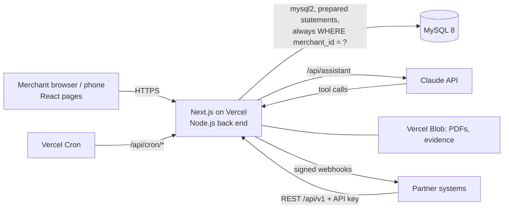
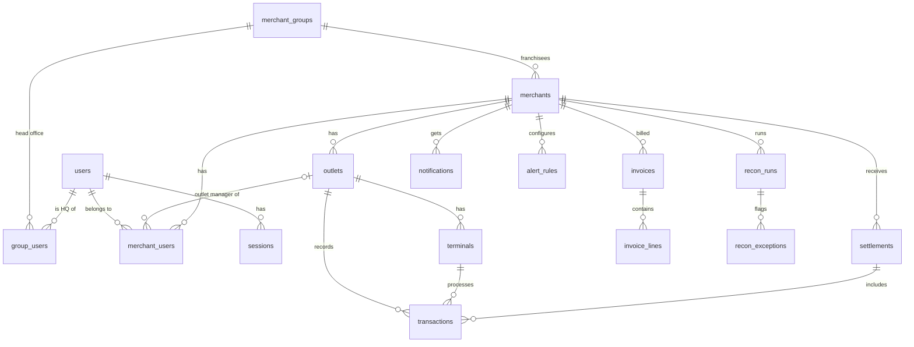

# Technical Design — NETS Merchant Portal

Version 0.2 · 2026-11-14 · Living document: update it in the same PR as any architecture change.

> **Change in v0.2:** the database is now **MySQL 8**, replacing Supabase Postgres, because the project requirements name MySQL and/or MongoDB for transactions, invoices and user data. See [ADR-001](adr/001-mysql-database.md).

## 1. Requirements and the database choice

Project requirements (confirmed firm, 2026-11-14):
- **Web development:** JavaScript / Node.js, a framework such as React, and building and consuming REST APIs (front and back end)
- **Databases:** MySQL and/or MongoDB for transactions, invoices and user data

How the design meets them:

| Requirement | How we meet it |
|---|---|
| JavaScript / Node.js | Plain JavaScript throughout. The back end is Next.js route handlers and server actions running on Node.js |
| React framework | Next.js 15, which is built on React |
| Building REST APIs | Public versioned REST API `/api/v1` with an OpenAPI 3.1 spec (§7.1). Our own pages use the same data layer |
| Consuming REST APIs | Claude API (assistant), integration adapters for Xero, QuickBooks, Shopify and SAP (§7.3), and NETS sandbox APIs when they arrive |
| MySQL for transactions, invoices, user data | **MySQL 8** holds all of it: `users`, `merchants`, `transactions`, `settlements`, `invoices` and the rest (§4) |
| MongoDB | Not used. The data is relational: reconciliation joins transactions to settlements to invoice lines and needs exact sums. Reasoning in [ADR-001](adr/001-mysql-database.md) |

**Database: MySQL 8** (InnoDB, `utf8mb4`). Only server code connects to it, through the `mysql2/promise` driver with prepared statements. There is no ORM: raw SQL keeps the queries visible and easy to review, and it is good evidence of database skills for assessors.

## 2. Tech stack

| Area | Choice | Why |
|---|---|---|
| Framework | **Next.js 15 (App Router), plain JavaScript (no TypeScript)** | First-class on Vercel; server components keep secrets server-side. Plain JS because the team has not learned TypeScript (decided 2026-11-12); JSDoc comments can document types where helpful |
| Back end | **Next.js route handlers + server actions on Node.js** | One codebase and one deploy for the front and back end; the REST API lives in `app/api/v1` |
| Styling / UI | **Tailwind CSS + shadcn/ui** (Radix primitives) | Accessible components out of the box, fast to theme for the chosen design |
| Charts | **Recharts** | Simple React API, responsive |
| Tables | **TanStack Table** | Sorting, filtering, pagination for transactions |
| Forms | **React Hook Form + Zod** | Validation shared between client and server |
| Database | **MySQL 8** via **`mysql2/promise`** (pool, prepared statements) | Meets the requirement; see §1 and ADR-001 |
| Migrations | Plain `.sql` files in `db/migrations/`, applied in order by `scripts/migrate.mjs`, which records them in a `schema_migrations` table | Simple and transparent; no extra tool to learn |
| Auth | **Our own email + password login**: `bcryptjs` hashes, a server-side `sessions` table and an httpOnly cookie (MFA later) | No hosted auth service needed; full control over sessions and logout |
| File storage | **Vercel Blob** | Invoice PDFs, dispute evidence, exports |
| Scheduled jobs | **Vercel Cron Jobs** calling `/api/cron/*` (protected by `CRON_SECRET`) | Nightly recon, alerts, weekly digests |
| Live updates | **Polling** (the notifications bell refreshes on page load and every 60 s) | Enough for a prototype; no realtime service needed |
| AI model | **Anthropic Claude: `claude-opus-5-5`** via the official `@anthropic-ai/sdk` | Strong tool use for safe data queries; streaming chat |
| Embeddings (RAG, Phase 2) | A small open embedding model (e.g. `gte-small` via Transformers.js in Node) or an embeddings API; vectors stored as JSON in MySQL | Chosen in Phase 2; the help centre is small, so similarity is computed in Node |
| Excel export | **ExcelJS** | Formatted .xlsx with multiple sheets |
| PDF export | **@react-pdf/renderer** | Invoice and report PDFs from React components |
| Email | **Resend** (Phase 1) | Alert and digest emails |
| Testing | **Vitest** (unit, plus integration tests against a test MySQL database), **Playwright** (end-to-end) | Integration tests prove merchant data isolation (§8) |
| CI/CD | **GitHub Actions** (lint, unit tests, integration tests with a `mysql:8` service container) + **Vercel** preview deploy per PR | |
| Docs | Markdown in `/docs`, diagrams in **Mermaid** | Versioned with the code |

AI cost note: `claude-opus-5-5` costs $4 / $20 per million input/output tokens. A typical copilot question uses roughly 3–6k tokens, so it costs a few cents. If demo volume makes cost matter, high-volume background jobs (such as nudge wording) can move to `claude-haiku-5-5` ($0.10 / $0.50) later. That is a team decision.

## 3. Architecture



**Layers (the back end):**
1. **Routes:** pages, server actions, `/api/v1/*`, `/api/assistant` and `/api/cron/*`. They check who is calling (session cookie or API key), then call the data layer and business logic. They never contain SQL.
2. **Data layer (`lib/data/`):** the only place SQL lives. Every function takes `merchantId` as its first argument, and every query on merchant-owned data includes `WHERE merchant_id = ?`.
3. **Business logic (`lib/metrics`, `lib/recon`, `lib/nudges`):** plain functions with no database access, unit-tested.

**Key rule: merchant isolation.** The merchant id always comes from the server-side session (or from the API key's owner), **never from the URL, the request body or the AI**. The database has no row-level security, so this rule plus the tests in §8 is what stops one merchant seeing another's data.

**Key rule: the AI never writes SQL.** The copilot can only call a fixed set of tools (e.g. `get_sales_summary(from, to, channel?)`). Each tool calls a `lib/data/` function with the **logged-in merchant's id, supplied by the server**. The model has no way to pass a different merchant id, so it cannot see another merchant's data, even if a user tries to trick it with a prompt injection.

### Folder structure (planned)

```
/app
  /(auth)/login
  /(portal)/dashboard  /transactions  /settlements  /invoices
  /(portal)/reconciliation  /reports  /assistant  /notifications
  /(portal)/offers  /campaigns  /lending  /services  /terminals
  /(portal)/business  /disputes  /integrations  /analytics  /settings
  /api/assistant/route.js      # streaming copilot
  /api/export/[type]/route.js  # xlsx / pdf
  /api/v1/...                  # public REST API (P1)
  /api/cron/...                # Vercel Cron targets
/components  (ui/, charts/, layout/)
/lib         (db.js, auth/, data/, assistant/tools/, recon/, format/)
/db          (migrations/*.sql)
/scripts     migrate.mjs, seed.mjs
/tests       (unit/, integration/, e2e/)
/docs
```

## 4. Data model (MVP core; later phases add tables)



MySQL conventions:
- Every primary key is named after its table: `merchant_id`, `transaction_id`, `user_id` and so on ([ADR-002](adr/002-table-named-ids-and-nets-identifiers.md)). They are `CHAR(36)` UUID strings. The generator creates them, so seeded data is the same on every machine
- NETS identifiers sit beside them: **MID** on merchants, **TID** on terminals, **STAN** on transactions (merchant → terminal → payment)
- Money is `BIGINT` cents (`amount_cents`, `fee_cents`…), never `FLOAT` or `DECIMAL` dollars
- Times are `DATETIME(3)` in **UTC**. Singapore days and hours are computed in SQL with `CONVERT_TZ(created_at, '+00:00', '+08:00')`. Singapore has no daylight saving, so the fixed offset is always right, and the server's time-zone tables don't need loading
- Fixed value lists use `ENUM(...)` columns; foreign keys and InnoDB everywhere; `utf8mb4`

| Table | Key columns |
|---|---|
| `users` | user_id, email (unique), password_hash (bcrypt), name, created_at, last_login_at |
| `sessions` | session_id, user_id, token_hash (SHA-256 of the cookie token), expires_at, created_at |
| `merchants` | merchant_id, mid (NETS merchant ID), group_id (franchise, nullable), legal_name, trading_name, uen, category (F&B, retail…), gst_registered |
| `merchant_groups` | group_id, name (a franchise brand; head office) |
| `group_users` | group_id, user_id, role (hq_owner): head office sees every franchisee, view only ([ADR-003](adr/003-franchise-tiers.md)) |
| `merchant_users` | merchant_id, user_id (→ users), role (owner/manager/cashier/accountant/outlet_manager), outlet_id (set = locked to that outlet) |
| `outlets` | outlet_id, merchant_id, name, address |
| `terminals` | terminal_id, tid (NETS terminal ID), merchant_id, outlet_id, serial_no, model, status |
| `transactions` | transaction_id, merchant_id, outlet_id, terminal_id, stan (6-digit trace number per terminal), **channel** (nets_qr, nets_click, enets, card, sgqr), amount, fee, status (success/failed/refunded), failure_code, settlement_id, created_at |
| `settlements` | settlement_id, merchant_id, business_date, gross, fees, net, status (pending/paid/delayed), expected_date, paid_date, bank_ref |
| `invoices` | invoice_id, merchant_id, period (month), total, status (unpaid/paid/overdue), due_date, pdf_path |
| `invoice_lines` | invoice_line_id, invoice_id, charge_type (MDR fee, terminal rental, …), qty, unit_price, amount |
| `recon_runs` | recon_run_id, merchant_id, period, run_at, matched_count, exception_count |
| `recon_exceptions` | recon_exception_id, recon_run_id, type (amount_mismatch, missing_settlement, settlement_delay, failed_payment, fee_mismatch), ref ids, expected, actual, status (open/resolved), note |
| `promotion_runs` / `promotion_run_outlets` | A 4-week promotion a merchant took up: promotion_run_id, merchant_id, promotion_key (from `lib/promotions/catalogue.js`), channel, starts_on, ends_on, stopped_on; one row per outlet in `promotion_run_outlets`. One running or scheduled run per channel per outlet, enforced in a locked transaction |
| `offer_takeups` / `offer_takeup_outlets` | An offer a merchant took up: offer_takeup_id, merchant_id, offer_key, starts_on, ends_on; one row per outlet. Also `outlets.is_online` |
| `notifications` | notification_id, merchant_id, kind, title, body, link, read_at |
| `alert_rules` | merchant_id, rule_type, threshold, channel (in_app/email), enabled |
| `kb_chunks` | kb_chunk_id, source_doc, heading, content, `FULLTEXT(heading, content)`; Phase 2 adds embedding (JSON) |
| `chat_messages` | session_id, user_id, role, content, created_at |
| `audit_log` | actor, action, entity, before/after, at |

All merchant-owned tables have an indexed `merchant_id` column, and every query on them filters by it (see §3 and §8).

## 5. Reconciliation logic (v1)

For a selected month:
1. **Transactions → Settlements:** sum the successful transactions per business date and channel, then compare with the settlement's `gross`. A difference greater than $0.01 is flagged as `amount_mismatch`.
2. **Missing / late settlements:** a settlement still `pending` after its `expected_date` is flagged as `settlement_delay`.
3. **Failed payments:** failed transactions are listed with the plain-language reason from the `failure_code` table.
4. **Settlements → Invoice:** recompute the MDR fees from the transactions and compare them with the invoice's fee lines. A difference is flagged as `fee_mismatch`.
5. Store the results in `recon_runs` / `recon_exceptions`, show a summary ("98.6% matched, 4 items need your attention") and allow export.

## 6. AI assistant design

- **Endpoint:** `POST /api/assistant` streams responses from `claude-opus-5-5` using tool use.
- **Data tools (MVP):** `get_sales_summary`, `compare_periods`, `get_busiest_times`, `get_channel_mix`, `find_transaction`, `explain_failed_payment`, `get_settlement_status`, `get_invoice`.
- **Help tool:** `search_help_centre(query)` searches `kb_chunks` and returns the top passages with their source, which the answer then cites.
- **Guardrails:** the system prompt tells the assistant to answer only from tool results, to say "I don't know" rather than guess, and to always state the date range. Tools are read-only in the MVP. Any later write actions (e.g. raising a refund) need user confirmation, plus maker-checker in Phase 4.
- **Summary card:** template-based in the MVP (deterministic). The LLM is used only for the chat.
- **Two modes (`ASSISTANT_MODE`):**
  - `rules` (MVP default, no AI, no key needed): keyword intent matching plus time-phrase parsing picks a data tool and fills a sentence template. Help questions return the best-matching help-centre answer verbatim, with its source. This is retrieval without generation, so it is **not** RAG.
  - `ai`: Claude chooses the same tools itself and writes the reply. Help questions use **RAG**: `search_help_centre` retrieves passages, and Claude answers from them with citations.
  - Both modes share the tools and the help-centre search, so switching is a config change.
- **Help-centre search in the MVP:** MySQL full-text search (`MATCH(heading, content) AGAINST(? IN NATURAL LANGUAGE MODE)`) over `kb_chunks`. Phase 2 adds embeddings for meaning-based search ("hybrid" keyword + vector): vectors are stored as JSON and cosine similarity is computed in Node, which is fast enough for a few hundred chunks.

## 7. Open API & integrations (two-way)

The portal is **API-first**: our own UI uses the same data layer as the versioned API that partners use, so integrations are never an afterthought.

### 7.1 Inbound: other services connect to us (Public REST API)

| Item | Decision |
|---|---|
| Style | REST + JSON, versioned base path **`/api/v1`** (Next.js route handlers on Vercel) |
| Contract | **OpenAPI 3.1** spec at `/api/v1/openapi.json`, rendered as interactive docs at `/developers` (Scalar or Swagger UI) |
| Auth (machine-to-machine) | **API keys** (P1) issued per merchant in *Settings → Developers*, stored hashed, with scopes; **OAuth 2.0 client-credentials** (P3) for partners like SAP/Xero |
| Scopes | `transactions:read`, `settlements:read`, `invoices:read`, `reports:read`, `refunds:write`, `webhooks:manage` |
| Data isolation | Every key belongs to one merchant. The route looks up the key's merchant and passes that id to `lib/data/`, exactly like a logged-in session |
| Rate limiting | Per key (e.g. 60 req/min), via Upstash Redis or a MySQL counter table; `429` + `Retry-After` |
| Conventions | Cursor pagination (`?cursor=&limit=`), ISO-8601 dates, amounts in cents (integers), `Idempotency-Key` header on POSTs, consistent error shape `{ error: { code, message } }` |
| Audit | Every API call is logged (key id, route, status) in `api_request_log` |

**Planned endpoints (v1)**

| Method | Path | Phase |
|---|---|---|
| GET | `/api/v1/transactions` · `/api/v1/transactions/{id}` | P1 |
| GET | `/api/v1/settlements` · `/api/v1/settlements/{id}` | P1 |
| GET | `/api/v1/invoices` · `/api/v1/invoices/{id}` · `/api/v1/invoices/{id}/pdf` | P1 |
| GET | `/api/v1/reports/sales?from=&to=&group_by=` | P1 |
| GET | `/api/v1/reconciliation/runs` · `/runs/{id}/exceptions` | P1 |
| GET | `/api/v1/disputes` · `/api/v1/refunds` | **Built** (read-only, `?page=N&outlet=`; answering a dispute uses server actions) |
| (server actions) | `startPromotionAction`, `stopPromotionAction`, `takeUpOfferAction` | **Built** (owner and outlet manager only, checked on the server; no public API yet, see [features/offers-promotions.md](features/offers-promotions.md)) |
| POST | `/api/v1/refunds` | P1 (with maker-checker in P4) |
| GET/POST/DELETE | `/api/v1/webhooks` (manage subscriptions) | P1 |
| GET | `/api/v1/terminals` · POST `/api/v1/service-requests` | P3 |

### 7.2 Outbound: we notify other services (Webhooks)

- Merchants or partners register a URL and pick events
- Events: `transaction.failed`, `settlement.paid`, `settlement.delayed`, `invoice.issued`, `reconciliation.completed`, `dispute.opened`, `alert.triggered`
- Each delivery is **signed** (HMAC-SHA256 in an `X-NETS-Signature` header, plus a timestamp to stop replays)
- Retries with exponential backoff (up to 24h) via a `webhook_deliveries` queue processed by a Vercel Cron route. Vercel Hobby cron runs at most once a day, so frequent retries may need a paid plan or an external scheduler (decide in Phase 1). A delivery log is visible in the UI

### 7.3 Connectors: we pull from or push to other services (Integrations hub)

- An **adapter pattern** in `/lib/integrations/<provider>/` with a common interface (`connect()`, `sync()`, `mapFields()`, `disconnect()`)
- Planned adapters: **SAP Business One / S/4HANA** (OData), **Xero**, **QuickBooks Online**, **Shopify**; Google Sheets as a simple option for small merchants
- OAuth tokens are stored encrypted (AES-256-GCM in app code, key in an environment variable); sync history goes in `integration_syncs`
- MVP/P3 approach: mock connectors with realistic responses first, then one real sandbox (Xero has a free developer sandbox)

New tables: `api_keys` (merchant_id, name, prefix, hash, scopes, last_used_at, revoked_at), `api_request_log`, `webhook_endpoints`, `webhook_deliveries`, `integrations`, `integration_syncs`.

## 8. Security & compliance

- **Merchant isolation** (replaces database row-level security):
  - SQL lives only in `lib/data/`. Every function takes `merchantId` first and filters by it
  - The merchant id comes only from the server session or the API key
  - A Vitest integration test for **every** data function seeds merchants A and B and proves that A's call never returns B's rows (`tests/integration/isolation.test.js`)
  - PR review checklist item: "every new query has `WHERE merchant_id = ?`"
- **SQL injection:** prepared statements (`?` placeholders) only. Never build SQL by joining strings with user input
- **Passwords and sessions:** bcrypt (cost 12). Session tokens are 32 random bytes, and only their SHA-256 hash is stored. The cookie is `httpOnly`, `Secure` and `SameSite=Lax`, with an 8-hour expiry. Logout deletes the session row. Login attempts are rate-limited per email and IP
- The app's database user has only `SELECT, INSERT, UPDATE, DELETE` on the app schema. Migrations run with a separate admin user
- Only server code connects to the database; the browser never talks to MySQL directly
- Secrets (database URL, API keys) live in Vercel environment variables and `.env.local`, never in git
- Synthetic data only (no real PII). Singapore **PDPA** principles are noted for any future real data
- Audit log for sensitive actions (exports, refunds, bank changes)

## 9. Environments

| Env | Where | Data |
|---|---|---|
| Local | MySQL 8 on each laptop (MySQL Community Server installer, or Docker `mysql:8`) + `next dev` | Seeded synthetic |
| CI | GitHub Actions `mysql:8` service container | Test fixtures |
| Preview | Vercel preview per PR → shared hosted MySQL dev database | Seeded synthetic |
| Production (demo) | Vercel production → hosted MySQL demo database | Seeded demo merchants |

**Hosted MySQL:** Vercel has no built-in MySQL, so we use a managed MySQL 8 service on a free or student tier that accepts TLS connections from Vercel (for example Aiven for MySQL or Railway). Pick one in Sprint 1, check its current free-tier limits, and record the choice here. Keep the demo data moderate (~50k transactions per merchant) so it fits a free tier.

**Provider requirements:** the database must support InnoDB foreign keys and FULLTEXT indexes (Aiven for MySQL and Railway are OK; PlanetScale/Vitess and TiDB are risky for our composite foreign keys and FULLTEXT). Use TLS (`DATABASE_SSL=true`, plus `DATABASE_SSL_CA` if the provider uses its own certificate authority). On Vercel each function instance has its own pool, so `lib/db.js` uses `DB_CONNECTION_LIMIT` (default 3 in production, 10 locally), `maxIdle: 1` and a 60 s idle timeout.
